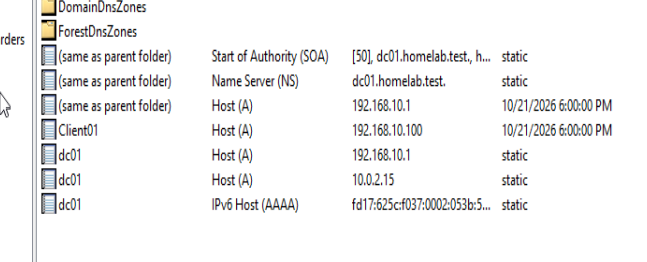
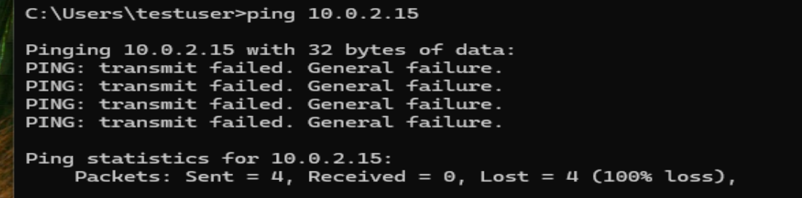
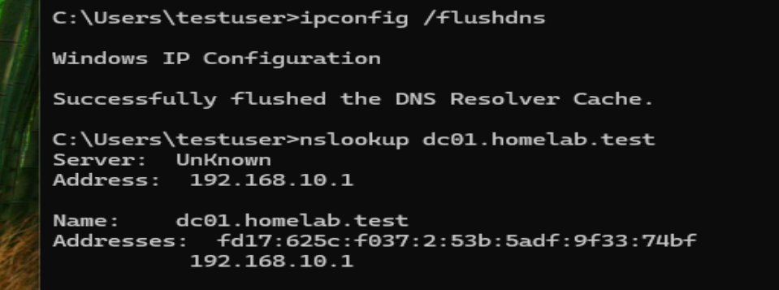
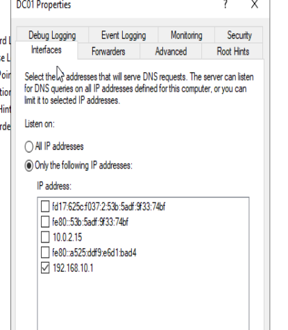
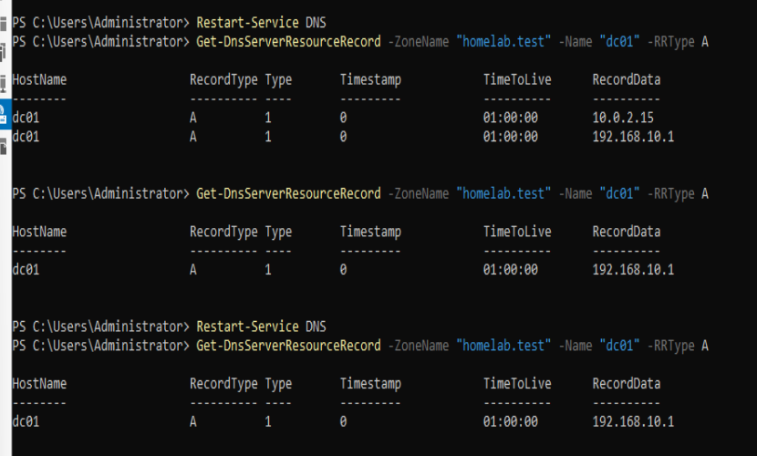
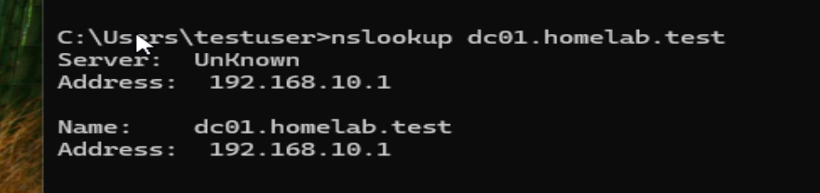

# Windows-Server-DNS-Troubleshooting
Hands-on Windows Server 2022 DNS troubleshooting lab focused on resolving duplicate A records, investigating recurring DNS registration issues, and verifying client connectivity.
# Windows Server DNS Troubleshooting — Duplicate A Records

## Project Overview

This project demonstrates troubleshooting a recurring DNS configuration issue in a Windows Server 2022 Active Directory homelab.

The domain controller (DC01) was registering two IPv4 addresses in DNS, including an address associated with its VirtualBox NAT adapter. This created a potential name-resolution and connectivity problem for internal clients.

The objective was to investigate the duplicate records, identify what triggered their reappearance, correct the configuration, and verify DNS resolution from a Windows 11 domain client.

## Lab Environment

| Component | Configuration |
|---|---|
| Hypervisor | Oracle VirtualBox |
| Domain Controller | Windows Server 2022 (DC01) |
| Client | Windows 11 (Client01) |
| Active Directory Domain | homelab.test |
| Internal Network | Labnet |
| DC01 Internal IP | 192.168.10.1 |
| DC01 NAT IP | 10.0.2.15 |
| Client01 IP | 192.168.10.100 |
| DNS Server | Windows Server DNS |

DC01 used two VirtualBox network adapters: NAT for external connectivity and an internal adapter for communication with Client01.

## 1. Problem Identification

While inspecting the `homelab.test` forward lookup zone, I discovered two Host (A) records for `dc01.homelab.test`:

- `192.168.10.1` — Internal Labnet address
- `10.0.2.15` — VirtualBox NAT address

The NAT address was not intended to be published for internal client access.



## 2. Network Connectivity Testing

From Client01, I tested connectivity to DC01's NAT address:

```cmd
ping 10.0.2.15
```

The command returned `PING: transmit failed. General failure`, with 100% packet loss.

I also tested the internal address:

```cmd
ping 192.168.10.1
```

The internal address responded successfully.

These tests demonstrated that the client could communicate with DC01 over Labnet, while the NAT address failed the ping test.



## 3. Initial DNS Correction

I removed the unwanted `10.0.2.15` A record from the DNS forward lookup zone.

On Client01, I cleared the DNS resolver cache and checked hostname resolution:

```cmd
ipconfig /flushdns
nslookup dc01.homelab.test
```

The DNS lookup returned the expected internal IPv4 address, `192.168.10.1`, along with an IPv6 address.



## 4. Investigating the Recurring Record

The unwanted NAT record had appeared during a previous homelab exercise, so I investigated why it kept returning.

The investigation included:

- Checking DNS registration settings on the NAT adapter.
- Reviewing DNS Server listening interfaces.
- Checking automatic DNS scavenging.
- Inspecting the Netlogon DNS registration file.
- Reviewing DNS Server settings using PowerShell.

The NAT adapter's DNS registration option was already disabled, and the Netlogon DNS file did not contain `10.0.2.15`.

To test whether the DNS Server service was involved, I restarted it and inspected the records:

```powershell
Restart-Service DNS

Get-DnsServerResourceRecord -ZoneName "homelab.test" -Name "dc01" -RRType A
```

**Result:** The unwanted `10.0.2.15` A record reappeared after restarting the DNS Server service.

This provided evidence that the recurring registration was associated with DNS Server startup.

## 5. Configuration Change

In DNS Manager, I opened:

**DC01 → Properties → Interfaces**

The DNS Server was initially configured to listen on all available IP addresses.

I changed the configuration to listen only on:

`192.168.10.1`

This restricted DNS service listening to the internal Labnet interface.



## 6. Resolution Verification

After updating the DNS Server interface configuration, I removed the unwanted A record and restarted the DNS Server service.

I then ran:

```powershell
Get-DnsServerResourceRecord -ZoneName "homelab.test" -Name "dc01" -RRType A
```

The result showed only:

```text
HostName    RecordType    RecordData
dc01        A             192.168.10.1
```

After another DNS Server restart, the unwanted NAT address did not return.

This confirmed that the configuration change prevented the duplicate record from reappearing during the tested restart sequence.



## 7. Client-Side Verification

Finally, I returned to Client01 and ran:

```cmd
nslookup dc01.homelab.test
```

The client successfully resolved the domain controller to:

```text
Server:  UnKnown
Address: 192.168.10.1

Name:    dc01.homelab.test
Address: 192.168.10.1
```

The unwanted `10.0.2.15` address was no longer returned.



## Root Cause and Findings

The DNS Server was configured to listen on all available interfaces, including the VirtualBox NAT adapter.

Testing demonstrated that the unwanted NAT A record reappeared after a DNS Server service restart. Restricting DNS listening to the internal interface and removing the unwanted record prevented its reappearance during subsequent restart testing.

These results support the conclusion that DNS Server interface configuration contributed to the recurring record registration, although the exact underlying registration mechanism was not independently confirmed.

## Skills Demonstrated

- Windows Server 2022 DNS administration
- DNS A record inspection and management
- DNS troubleshooting using `nslookup`
- Network connectivity testing using `ping`
- PowerShell DNS administration
- DNS Server interface configuration
- Troubleshooting multihomed servers
- Root cause investigation
- Service restart and post-change verification
- Technical documentation

## Key Takeaways

This project reinforced the importance of investigating recurring issues rather than repeatedly applying temporary fixes.

I learned how multiple network adapters can complicate DNS configuration, how to distinguish DNS resolution from network connectivity, and how to validate a configuration change by reproducing the original problem.

The experience reflects a practical IT support workflow: identify the symptoms, collect evidence, investigate possible causes, apply a targeted correction, and verify the result.
